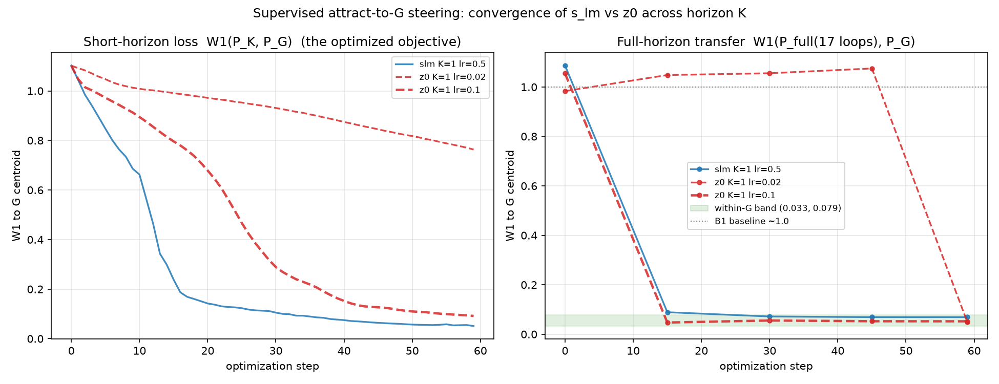

# Steering 7txw into the good basin: `s_lm` vs `z0` (supervised attract-to-G)

Deep-dive companion to `summary.md` §8. Question: can we *drive* the 7txw baseline
prediction into the good antibody–antigen docking basin (G) by gradient-steering an
internal tensor on the cheap short-horizon distogram, and which tensor is the better lever?

Two levers, same supervised objective — minimize `W1(P_K(leaf), P_G)`, where `P_K` is the
antibody×antigen cross-distogram read after K recycling loops and `P_G` is the mature-G
(loop-16) centroid over good seeds {10,14,33,39}:

- **`s_lm`** — the LM single representation, lifted to `lm_z` and **re-injected every recycling
  loop** (persistent influence).
- **`z0`** — the initial recurrent pair state (`_init_pair_state`, trunc-normal, std≈0.04), the
  loop-0 value of the parcae SSM recurrence; **decays as ~a^t** while the input is re-injected
  (transient influence).

**Decisive metric = transfer:** a leaf steered to look like G at a short horizon K is only useful
if, run the full 17 loops, it still lands near G. Within-G band (good seeds to their own centroid)
is **0.033–0.079**; the unsteered B1 baseline sits at **~1.0**. The W1→G proxy is **validated**:
decoding confirmed it rank-orders DockQ (below).

---

## TL;DR

1. **Both levers can reach G.** z0 at K=3 decodes to **DockQ 0.92**; s_lm reaches the G band at
   every K tested.
2. **`s_lm` is the more robust lever — it decodes to good DockQ (0.88–0.93) at ALL horizons
   K∈{1,3,6,9}.** Because it is re-injected every loop, even a shallow-horizon gradient shapes the
   whole trajectory → smooth, fast, stable convergence. **z0 reaches good DockQ in an *early*
   window (K=1 and K=3 both → DockQ ~0.92 with adequate lr); it dies at large K** (decay-vanished
   gradient) — see §2.
3. **`z0` is an early, transient lever.** Its influence decays through the SSM, so it only bites in
   an early window. But its earlier "K=1 fails" verdict was an **optimizer artifact** (lr/steps),
   not a horizon limit — see below.
4. **No loop-1 legibility floor** (correcting an earlier claim): with adequate lr, z0 K=1 drives the
   short loss to 0.09 and reaches the G band by step 15.
5. **"In-distribution" is a heuristic, not a law.** Every z0 hit reached G while drifting *off* the
   trunc-normal manifold; what actually predicts a good complex is the *output* (W1→G / DockQ), not
   the input's distance from its training distribution.

---

## 1. Horizon sweep (original 40-step runs)

Full-horizon transfer `W1→G(16)` and decoded DockQ(A|C, ipTM-selected). Baseline ~1.0; band
0.033–0.079.

| K | s_lm `W1→G` | s_lm DockQ (oracle) | z0 `W1→G` | z0 DockQ |
|---|---|---|---|---|
| 1 | 0.106 ✓ | **0.878** (0.920) | 1.073 ✗ (40-step) | 0.029 (40-step) → **0.922** (60-step lr0.1) |
| 3 | 0.078 ✓ | **0.932** (0.939) | **0.048 ✓** | **0.923** (0.933) |
| 6 | 0.075 ✓ | **0.882** (0.917) | 1.031 ✗ | 0.030 |
| 9 | 0.251 | **0.889** (0.954) | 1.087 ✗ | 0.028 |

(DockQ = A|C, ipTM-selected; oracle-best in parentheses. Both decode-confirmed.)

- **s_lm transferred — and decoded to good DockQ (0.88–0.93) — at ALL four K.** Fully robust.
- **z0 reached good DockQ at K=3 only** (0.92) in this 40-step sweep — but the K=1 failure was
  step/lr-starvation (§2), not a horizon property. K=9's failure looks genuinely real (short-loss
  gradient never moved → z0 fully decayed by loop 9).
- **DockQ validates the proxy at the extremes:** z0 W1→G 0.048 → DockQ 0.92; all three ~1.0 horizons
  → DockQ ~0.03. **But the proxy under-sold s_lm K=9:** W1→G 0.251 (above the band) still decoded to
  DockQ 0.889 — so a mid-range W1 (~0.1–0.3) is ambiguous, reliable only at the <0.1 / ~1.0 extremes.
- **ipTM trap confirmed:** z0 K=9 had ipTM 0.855 (≈K=3's 0.880) but DockQ 0.028 — a confident decoy.
  Do not trust ipTM here.

## 2. Convergence diagnostics (per-step, 60 steps)

Left = the optimized short-horizon loss; right = full-horizon transfer (the within-G band shaded).

**s_lm K=1 (lr=0.5):** smooth and fast — short loss → 0.05, transfer in the G band by step ~15,
then **plateaus** at 0.069 (stable through step 59, no overshoot). The loop-1 read is fully
informative because the steered s_lm is re-injected every loop.

**z0 K=1, lr=0.02 vs lr=0.1 — the optimizer test:**

| | lr=0.02 | lr=0.1 |
|---|---|---|
| final short loss | 0.76 | **0.092** |
| transfer (full W1→G) | pinned ~1.0 until step 45, snaps to **0.049 at step 59** | **in band (0.047) by step 15** |
| final `dev` (frac >3σ off-manifold) | 0.39 | 0.66 |

- **K=1 z0 was lr/step-starved, not horizon-limited.** At lr=0.1 it reaches G ~4× faster. The
  original "K=1 collapsed" was 40 steps at lr=0.02 stopping before the late snap.
- **No legibility floor.** The earlier claim that z0's loop-1 short loss "floors at 0.76" was wrong
  — that was slow convergence; at lr=0.1 it reaches 0.092 (≈ s_lm's 0.051).
- **Transfer is a discrete late snap for z0** (held at B1 then jumps into the band), vs s_lm's smooth
  descent — the commit-then-correct basin dynamics.

- **Decode-confirmed (best-short-loss leaf):** z0 K=1 → **DockQ 0.922** (lr=0.1) and **0.923**
  (lr=0.3) — matching z0 K=3 (0.923) and burying the stale 40-step "0.029". Beyond the too-low
  lr=0.02, **lr doesn't change the outcome** (0.1 vs 0.3 → same DockQ); lr=0.3 only reaches the band
  faster. Best-short-loss didn't diverge from transfer here (best leaf @step 59, full_w1 0.052).
  *(z0 K=3 lr={0.1,0.3} still running; DockQ to be added.)*

*(s_lm K=3 and z0 K=3 at 60 steps were interrupted by GPU contention; the figure auto-includes
their curves when complete — rerun `plot_converge.py`.)*

## 3. Mechanism: persistence vs transience (parcae SSM)

The trunk is an SSM-style recurrence over the 17 recycling loops:
`z ← a·z + b·(normalized z_init + LM signal)`, with a learned per-channel decay `a<1`
(`a = exp(−delta·exp(log_a))`). Two consequences:

- **`s_lm` feeds the input term, re-added every loop → persistent.** A steered s_lm influences all
  17 loops, so the short-horizon gradient is a faithful guide to the full trajectory → transfers at
  every K.
- **`z0` is the initial state, multiplied by `a` each loop → transient.** It only has leverage in an
  early window (basin-legible *and* not-yet-decayed). Past that window (K=6,9) the gradient vanishes.

This single property explains the whole s_lm-vs-z0 difference.

## 4. Does "in-distribution" matter?

The original motivation for masking / manifold constraints was "stay in-distribution so the trunk
emits a foldable structure." The data argues it is a **heuristic, not a requirement**:

- z0 K=3 reached **DockQ 0.92 while 32% off** the ±3σ trunc-normal init; z0 K=1 lr=0.1 hit the band
  at **66% off**; supervised s_lm steers ran `dev≈0.5` (further from baseline than the "bad" 15-step
  repulsion) and still transferred. Off-manifold *input* ≠ bad *output*.
- The 15-step s_lm repulsion failure (`summary.md` §8) was off-manifold **and** unfoldable, but the
  cause was *pure repulsion with no target fleeing into garbage* — off-manifold was correlated, not
  causal.
- **What actually matters is output validity** (foldable + correct), measured directly by DockQ and
  proxied by the validated W1→G. The in-distribution constraint is a useful stand-in only in the
  *blind/label-free* regime where you lack an output-validity signal — and it matters more for
  information-bearing tensors (`s_lm`) than for `z0`, which is noise the network is trained to be
  robust to.

## 5. Open questions / next

- **Decode the rescued K=1 z0** (lr=0.1, 60-step) to confirm proxy→DockQ (steer_converge does not
  save z — re-run that config with z-saving).
- **Clamped in-manifold z0** (project to ±3σ each step): does an *in-distribution* z0 still reach G?
  Only interesting for the blind regime, per §4.
- **z0 K=3 / s_lm K=3 convergence curves** — finish the two interrupted 60-step runs.

## Artifacts

| | path |
|---|---|
| Convergence runner (per-step CSV) | `analysis/grad_steer/steer_converge.py` |
| Convergence plot | `analysis/grad_steer/plot_converge.py` → `analysis/figs/steer_converge.png` |
| Horizon runners | `analysis/grad_steer/steer_horizon.py` (s_lm), `steer_z0.py` (z0) |
| Decode → DockQ | `analysis/grad_steer/decode_steered.py`, `eval/eval_ost_foldbench.py` |
| Per-step loss CSVs | `results/csv_files/steer_converge_{slm,z0}_K*_lr*.csv` |
| z0 horizon DockQ | `results/csv_files/dockq_ost_K0{1,3,6,9}_all_samples.csv` |
| s_lm horizon DockQ | `results/csv_files/dockq_ost_slmH_K0{1,3,6,9}.csv` |
