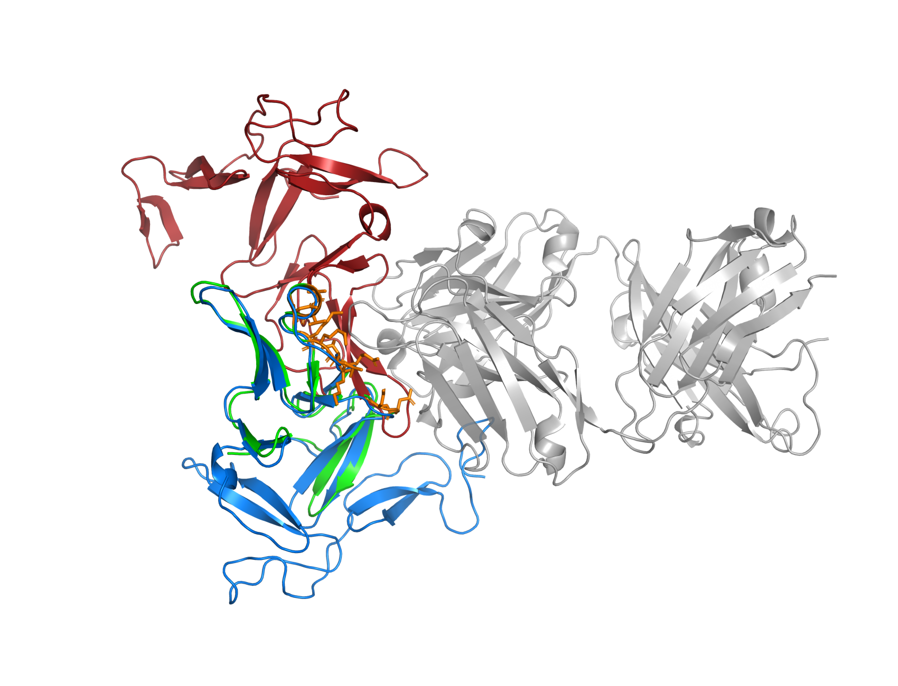
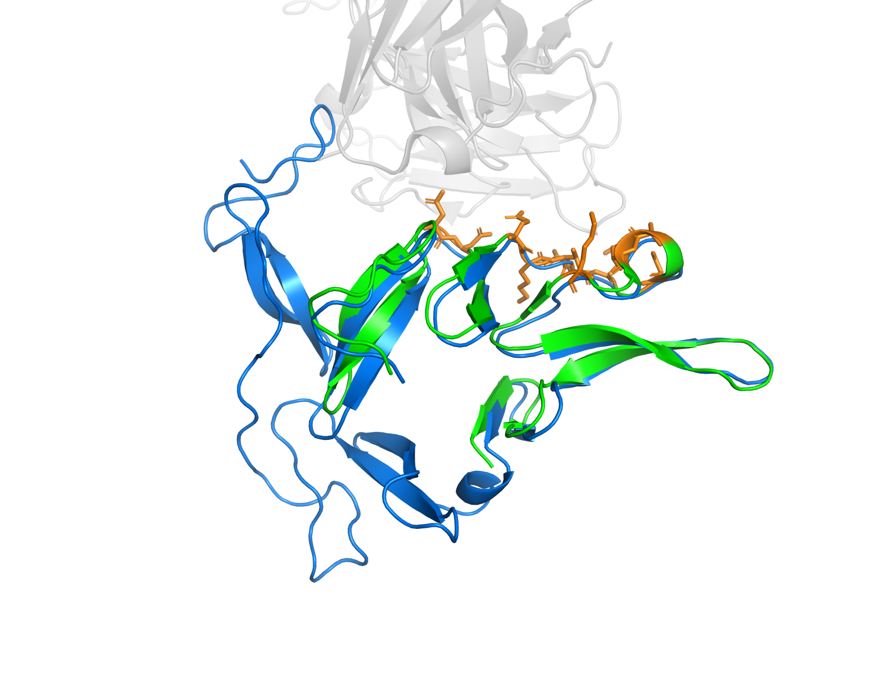
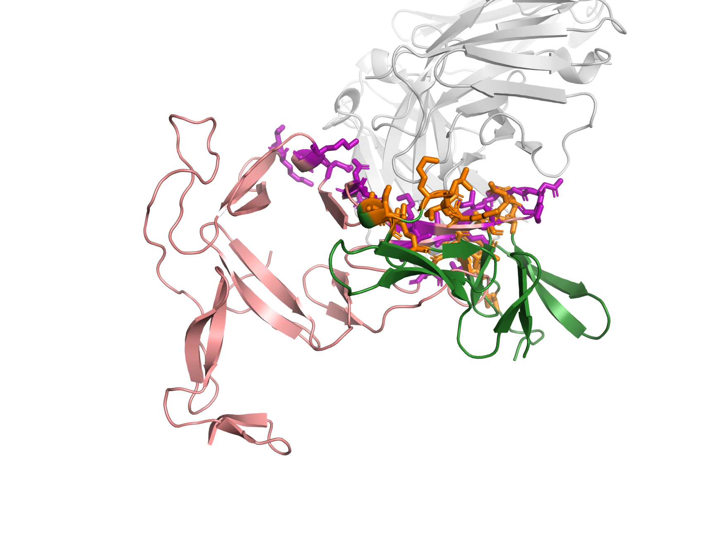
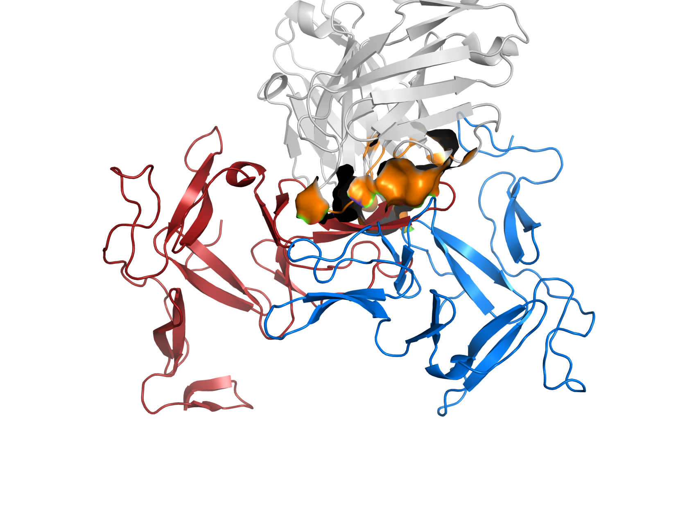
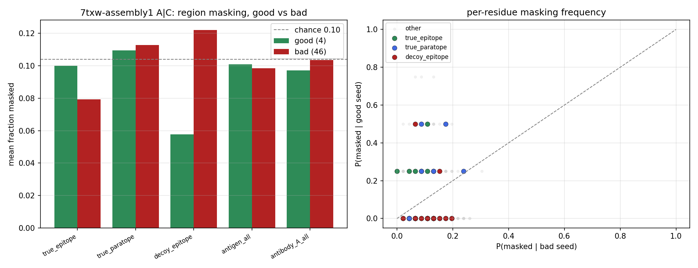

# Why test-time sampling rescues 7txw A|C: an orientation problem

**Case study:** `7txw-assembly1`, antibody–antigen interface **A|C** (chains A+B = a Fab; chain C = the antigen).
**Model / run:** ESMFold2-Fast (single-sequence), test-time sampling with `lm_mask_pct=0.1`, `lm_dropout=0.3`, 50 seeds × 5 diffusion samples.
**Score:** DockQ (0–1; ≥0.8 high, 0.49–0.8 medium, 0.23–0.49 acceptable, <0.23 incorrect).

---

## TL;DR

- Only **4 of 50 seeds** (10, 14, 19, 33) predict the complex correctly (DockQ ≈ 0.84–0.95). The other 46 fail (≈0.03). The no-mask baseline also fails (0.04).
- **Both proteins fold correctly in essentially every seed.** The antibody and the antigen monomers are right (~1 Å) regardless of seed.
- **The only thing that varies is how the antigen is oriented against the antibody.** This is a *docking/orientation* problem, not a folding problem.
- **The failures are not random:** 34 of 50 seeds collapse into a *single* wrong orientation — the antigen **flipped ~180°** so a different face contacts the antibody.
- The input mask is the *cause* of which orientation a seed picks, but we found **no interpretable "key residue" mask pattern** shared by the good seeds (the effect is distributed; analysis is also underpowered at n=4).
- The model's **confidence (`pair_iptm`) partially separates** right from wrong — here, picking the single most-confident seed would have returned a correct structure.

---

## 1. A few seeds succeed, most fail

Per-seed DockQ (best of each seed's 5 samples):

| | value |
|---|---|
| good seeds (≥0.5) | **4** — {10, 14, 19, 33} |
| bad seeds (<0.23) | 46 |
| no-mask baseline | 0.04 |
| best seed | 0.95 |

The good seeds are consistent internally (all 5 of their diffusion samples succeed), and the bad seeds consistently fail — so the outcome is decided at the **seed** level, not the per-sample noise level.

*Script: `check_good_bad.py`*

## 2. It's orientation, not folding

Superposing each prediction onto the antibody and measuring the rest (all 50 seeds, vs ground truth):

| Quantity | median | notes |
|---|---|---|
| Antibody (chain A) fold RMSD | **0.91 Å** | 45/50 seeds < 2 Å — antibody always correct |
| Antigen (chain C) fold RMSD | **1.04 Å** | monomer almost always correct |
| **Antigen docking pose RMSD** | **29.9 Å** | spans 1.4–55 Å; only the 4 good seeds are < 5 Å |

Both building blocks are built correctly every time; what changes is **where/how the antigen sits**.

*Overview: grey = antibody; green = native antigen; blue = a good seed (sits on the native pose); red = a bad seed (parked elsewhere). Script: `compare_7txw_poses.py`, rendered by `render_7txw_poses.py`.*

*The good seed (blue) and ground truth (green) antigens are nearly superimposable at the true epitope (orange). The extra blue loop is an antigen tail unresolved in the crystal structure, not an error.*

## 3. The failures share ONE dominant wrong orientation

Clustering all 50 antigen poses (after antibody superposition; two poses within 10 Å = "same orientation"):

| Cluster | # seeds | mean DockQ | what it is |
|---|---|---|---|
| 0 | **34** | 0.04 | **the dominant decoy orientation** |
| 1 | **4** | **0.92** | the native pose (the good seeds) |
| 2 | 3 | 0.04 | a secondary decoy |
| 3 | 2 | 0.08 | a minor decoy |
| 4–10 | 1 each | ~0.04 | one-off poses |

So two-thirds of all seeds agree on the *same* wrong answer. This is the signature of two competing **attractors** — a deep wrong basin and a shallow right one — and test-time sampling occasionally lands in the right one.

*Script: `cluster_antigen_poses.py`*

## 4. What the dominant decoy actually is: a ~180° flip

Characterizing the dominant decoy (representative seed_0) against the native complex:

| Measure | Value |
|---|---|
| Rigid rotation of the antigen body | **174.7°** (≈ end-for-end flip) |
| Centroid shift | 17.8 Å |
| Residual after rigid fit | 1.01 Å (= monomer fold diff → pure re-orientation) |
| True vs decoy epitope overlap | **0 residues** |
| Antibody region contacted (paratope) | same CDR patch (res 32–61) in both |

The antigen is flipped so a **different, non-overlapping face** is presented to the antibody — yet it lands on the **same CDR region**, so the decoy *looks like a legitimate antibody–antigen interface*. That plausibility is why so many seeds fall into it.

*Same antibody (grey). Green = native antigen with its true epitope (orange sticks) in the binding site. Salmon = the decoy antigen, rotated ~180° so a different patch (purple sticks = decoy epitope) occupies the same pocket. Both epitopes are crammed into the same CDR spot; the bodies point opposite ways. Script: `decoy_orientation.py`.*

*The native paratope (orange surface) is the antibody's CDR patch. The good antigen (blue) presses onto it; the bad antigen (red) is rotated and shoved to the side — right region, wrong orientation.*

**Consequence:** 34 of 46 bad seeds have *both* monomers folded correctly, so they are one correct rotation away from being right. The hard part is not generating the native pose (4 seeds already do) — it is *knowing which orientation is correct*.

## 5. Why does masking help? (no interpretable "key residue" signal)

ESMFold2-Fast is single-sequence, so the only source of seed-to-seed diversity is the input residue mask (drawn once per seed). We tested whether the good seeds masked particular **key residues** (true epitope / paratope / the decoy face):

*Fraction of each region masked, good vs bad seeds (left); per-residue masking frequency (right). Everything sits near the ~10% chance line; no region or residue cleanly separates good from bad. Script: `key_residue_masking.py`.*

- Masking of the true epitope, paratope, and decoy face is **indistinguishable** between good and bad seeds (all ≈ the 10% chance rate).
- **No residue is masked by all 4 good seeds** but spared by the bad ones.
- Only a weak, non-significant hint that good seeds mask the *decoy* face slightly less (0.06 vs 0.12, p≈0.12).

**Interpretation:** the mask *is* causal (it determines which orientation basin a seed falls into), but its effect is **distributed**, not a clean key-residue pattern — and with only 4 good seeds the per-residue test is underpowered.

> **Reproduction was verified exact.** The masks we analyzed match the real run's masks bit-for-bit (50/50 seeds), confirmed by loading the model and capturing the actual mask. The check guards against a silent failure mode (fp8 padding changing the tensor shape). *Script: `verify_mask_reproduction.py`.*

## 6. Can we tell the good seeds from the bad ones?

Confidence (`pair_iptm`, best sample per seed):

| group | mean | range |
|---|---|---|
| good (native pose) | **0.527** | 0.412–0.569 |
| bad (decoy poses) | 0.296 | 0.099–0.493 |

The native pose scores higher on average, and the **single most-confident seed is a good one** (0.569 > best decoy 0.493) — so top-1 confidence selection would rescue 7txw here. But the distributions overlap (15/46 decoy seeds score as high as the worst good seed), so confidence is a useful-but-fragile selector, not a clean separator.

## 7. Takeaways

1. For this interface, ESMFold2-Fast reliably **folds both proteins and finds the right binding region**; it only fails at **choosing the antigen's orientation**.
2. There is a **dominant wrong orientation** (a ~180° flip) that most seeds adopt; test-time sampling works by occasionally escaping it.
3. The benefit of masking is **not** explained by masking specific key residues — it appears to be a distributed input perturbation that reshuffles which orientation the model commits to.
4. The real bottleneck is **scoring/selecting** the correct orientation. Encouragingly, the model's own confidence already leans the right way here.

---

## Scripts used

| Script | Purpose |
|---|---|
| `check_good_bad.py` | Identify good/bad seeds per interface from the DockQ CSV |
| `compare_7txw_poses.py` | Fold RMSD, antigen pose RMSD, epitope overlap (core analysis) |
| `where_bad_dock.py` | Which antibody residues the antigen contacts (paratope) |
| `cluster_antigen_poses.py` | Cluster the 50 antigen orientations |
| `decoy_orientation.py` | Quantify the dominant decoy (rotation, faces, confidence) |
| `key_residue_masking.py` | Did good seeds mask key residues? (region + per-residue) |
| `verify_mask_reproduction.py` | Confirm reproduced masks match the real run exactly |
| `render_7txw_poses.py` | Render the 3D figures (PyMOL) |

**Data:** `results/csv_files/dockq_ost_esmfold2fast_tts_all_samples.csv`; predictions under `esmfold2fast_tts/7txw/seed_*/`; ground truth `7txw-assembly1.cif`.

## Glossary

- **Epitope** — the antigen residues that contact the antibody (the antigen's binding face).
- **Paratope** — the antibody residues that contact the antigen; normally the **CDR** loops (the antibody's binding tip).
- **Fab** — the two-chain (heavy+light) antigen-binding part of an antibody; here chains A+B.
- **Pose / orientation** — the 6-DOF (position + rotation) arrangement of the antigen relative to the antibody.
- **Decoy** — a plausible-looking but incorrect predicted pose.
- **DockQ** — 0–1 interface-quality score vs the true complex.
- **`pair_iptm`** — the model's confidence in the interface between two chains.
