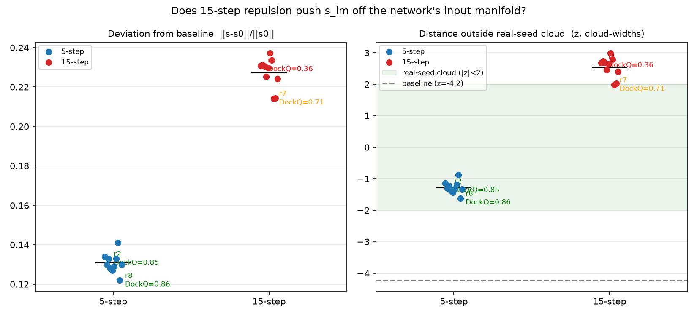

# 7txw antibody–antigen TTS: findings summary

Consolidated summary of the test-time-sampling (TTS) investigation on **`7txw-assembly1`,
interface A|C** (chains A+B = a Fab antibody; chain C = the antigen). Model is
**ESMFold2-Fast** (single-sequence), run with input LM masking (`lm_mask_pct=0.1`) and
per-loop LM dropout (`lm_dropout=0.3`); each seed draws one mask + dropout schedule and
produces 5 diffusion samples. Score is **DockQ** (≥0.8 high, 0.49–0.8 medium,
0.23–0.49 acceptable, <0.23 incorrect).

> This file is the current, consolidated view. `docs/7txw_orientation_findings.md` is the
> earlier write-up (n=50 era); a few of its claims are **superseded** here — most importantly
> the "no interpretable mask pattern" null, which was an n=4 power problem and is now overturned.

---

## TL;DR

1. **It's an orientation problem, not folding.** Both monomers fold correctly in essentially
   every seed (~1 Å); the only thing that varies is the antigen's **docking pose**. Only a
   handful of seeds find the native orientation; most collapse into a dominant wrong basin.
2. **The bad cloud is two basins, and one of them is a *confident decoy* (B2)** — a wrong-register
   dock on the correct CDR region that the model rates as confidently as the right answer.
   This defeats ipTM and every cheap geometry/CDR heuristic.
3. **The orientation decision is encoded in the pairformer-z *trunk* representation**, not the
   ESMC LM embedding, and it is a **diffuse, low-dimensional** shift, not a sparse interface edit.
4. **Mechanistically, "good" = a late, discrete recycling escape** from the universal default
   basin B1 toward the good basin G (loops ~3–12). Every seed starts in B1; early loops are
   uninformative.
5. **What sets the basin:** the per-seed input mask carries a real but modest prior (good seeds
   over-mask antigen residues C48–C50 near the epitope; CV AUC 0.62), and per-loop LM dropout
   noise is load-bearing for the borderline seeds. Outcome is a knife-edge commitment that CUDA
   nondeterminism alone can flip.
6. **A near-free detector exists** (cross-block distogram-KL) that separates the basins better
   than the raw rep — but it's a *relative* metric (needs a labeled/known-good reference), not a
   standalone selector.
7. **Steering is a working proof-of-mechanism.** Gradient-steering the LM single-rep `s_lm` on the
   cheap distogram drives the baseline into true G — label-free, DockQ ~0.85 — provided the
   steer stays on the network's input manifold (§8). Other selection/steering heuristics were
   refuted (§9).

---

## 1. The problem: orientation, not folding

- Antibody fold is constant across seeds (~0.91 Å vs GT); antigen monomer fold mostly constant
  (~1.04 Å). The only variable that tracks DockQ is the antigen **docking pose**: good seeds
  <5 Å, bad seeds 10–55 Å, with 0 native-epitope overlap.
- The dominant decoy is a **~180° flip** of the antigen that presents a different, non-overlapping
  face — but lands on the **same CDR patch**, so it looks like a legitimate interface. That
  plausibility is why most seeds fall into it.
- Outcome is decided at the **seed** level, not the per-sample level: all 5 samples within a seed
  agree on the basin.

*Scripts: `compare_7txw_poses.py`, `cluster_antigen_poses.py`, `decoy_orientation.py`,
`where_bad_dock.py`. Figures: `docs/figs/7txw_overview.png`, `7txw_decoy_flip.png`,
`7txw_paratope_view.png`.*

## 2. Basin structure: G / B1 / B2 and the confident decoy

K-means on the loop16 pairformer-z PCA splits the bad cloud into two basins (60-seed reps run):

| Basin | n | DockQ(A\|C) | interface ipTM | what it is |
|---|---|---|---|---|
| **G** (good) | 4 | 0.93 | 0.54 | native pose {10,14,33,39} |
| **B1** | 41 | 0.047 | 0.21 | dominant default decoy |
| **B2** | 13 | **0.030** | **0.51** | **confident decoy** — worst DockQ, near-good confidence |

**B2 is the hard case.** It docks the antigen on the CDR tip in the wrong rotational register.
It matches good on ipTM (0.51 vs 0.54), antigen pLDDT (0.87), interface PAE (it is *more* certain
than the correct pose), and CDR-fraction of paratope (0.68 vs G's 0.55). A **CDR-reward reranker
fails** — B2 is on the CDRs as much as good. The confidence head measures self-consistency, not
correctness, and a rigid wrong-register dock is maximally self-consistent. **Only the trunk pair
rep (and the distogram-KL derived from it) separates B2 from G.**

*Scripts: `why_b2_confident.py`, `anarci_cdr.py` (ANARCI env). See §7.*

## 3. Dynamics: universal B1 default, late discrete escape

Tracing each seed's cross-block distogram across the 17 recycling loops:

- **B1 is the universal default.** Every seed — good and bad — is nearest B1 in loops 0–2. Early
  loops are uninformative; all trajectories look identical.
- **The no-mask/no-dropout baseline stays in B1 for all 17 loops and sinks deeper.** With no
  perturbation there is no escape attempt — recycling just tightens the default commitment. The
  mask perturbation is what creates the *possibility* of escaping B1.
- **Good seeds escape B1 → G at seed-specific loops, always via B1, never via B2**
  (seed10 @loop4, 14 @5, 39 @7, 33 @9). Bad seeds either branch B1→B2 or never leave B1.
- So the outcome is a **late, discrete branching event (loops ~3–12)** — commit-then-correct, not
  divergent-from-the-start. This **kills "predict good from early loops."** The actionable window
  for any mid-trunk intervention is the pre-escape stretch loops ~3–12.
- The cheap distogram trajectory matches the expensive diffuse-from-loop DockQ "snap" ordering
  (10 earliest → 33 latest), so it's a faithful free proxy for the decode trajectory.

*Scripts: `distogram_loop_trajectory.py`, `distogram_baseline_trajectory.py`,
`pca_pairformer_loops.py`. Figs: `analysis/figs/distogram_loop_trajectory.png`.*

## 4. Where the signal lives: the trunk rep, diffusely

- **Pairformer-z trunk rep separates the good seeds; the ESMC LM rep does not.** Unsupervised PCA
  on the final-loop pairformer-z clusters the 4 good seeds tightly and in isolation; the same PCA
  on the final-layer ESMC embedding leaves them scattered. The separation builds over loops 6–13
  and plateaus (silhouette ~0.62) — consistent with the late-commitment dynamics in §3.
- **Localized to the antigen.** Block-wise PCA pins the signal to every chain-block touching the
  antigen C (A×C +0.71, B×C +0.68, C×C +0.53) and *no* antibody-internal block. A×C alone (+0.71)
  beats the full rep (+0.62) — antibody-internal blocks are outcome-noise that dilute it. Good and
  bad seeds represent the antibody scaffold identically; they differ specifically in antigen
  placement.
- **The rep difference is diffuse, not interface-local.** Where the predicted *geometry* changes
  is sharply localized to the antibody↔antigen cross-blocks (struct C×C/cross ratio 0.12), but the
  *rep* difference is non-zero everywhere (rep C×C/cross ratio 0.63 — ~5× more signal bled into
  geometry-conserved regions). The trunk pair rep is a contextual embedding of the global pose, not
  a distance matrix — reorienting the antigen shifts the whole representation. **Don't expect the
  good/bad direction to be a sparse, interface-local edit.**

*Scripts: `pca_pairformer_reps.py`, `pca_esmc_reps.py`, `pca_blocks.py`, `pca_blocks_perm.py`,
`rep_diff_vs_struct_diff.py`. Figs: `analysis/figs/rep_vs_struct_maps.png`, `rep_vs_struct_scatter.png`.*
**Caveat:** n=4 good seeds; separation is unsupervised (PCA never saw labels) so more convincing
than a supervised fit, but a permutation/robustness null is still outstanding.

## 5. What sets the basin: mask prior + dropout noise

**Mask pattern (powered, n=2060 — overturns the earlier n=4 null).** With the full seed set
(good ≥0.7 best-of-5, n=88; bad <0.23, n=1919):

- No global confound — good vs bad mask the same amount overall and per chain.
- Per-residue (Fisher + BH-FDR): antigen residues **C48** (RR 3.7, q≈0), **C49** (q=0.002) and
  **C50** (a native epitope residue, q=0.05) survive FDR<0.05. Signal is antigen-localized,
  clustered C48–C50 near the epitope: good seeds over-mask there.
- Omnibus L1-logistic (mask→good, 5-fold CV): **AUC 0.62** vs 0.50 null, permutation p=0.01.

So the mask carries a **real but modest** basin prior (AUC 0.62), not a deterministic switch —
consistent with the antigen-C trunk localization (§4). The deferred causal test is force-mask
C48–C50 vs a size-matched control (`docs/mask_pattern_plan.md`).

**Dropout is load-bearing for the borderline seeds.** Mask alone pins seeds 10/33 in the good
basin (5/5 with and without dropout). Seeds 14/39 are only brought *near* the watershed by the
mask; **per-loop LM dropout noise reliably tips them over** (14: 5/5 with dropout → 1/5 without;
39: 4/5 → 0/5). Basin commitment is knife-edge — CUDA nondeterminism alone flips it both ways.
Turning dropout off doesn't lower the success *rate* (it rescues other seeds, e.g. 19 flips
0.04→0.95) but reshuffles *which* seeds are good. **Good seeds are a noise-config artifact, not
intrinsic; the real lever is noise diversity** (the union over configs is larger than any single
config).

**Plumbing:** at inference the trunk's standard dropout is OFF (`model.eval()`); the only live
stochasticity is `F.dropout(lm_z, …, training=True)` on the LM representation, re-sampled fresh
each recycling loop. The mask is a deterministic per-seed `lm_z` perturbation; lm_dropout is
per-loop `lm_z` noise; the pairformer trunk itself is deterministic (modulo CUDA).

*Scripts: `mask_pattern_powered.py`, `run/esm/run_7txw_reps.py`, `analyze_masks.py`.
CSVs: `mask_pattern_7txw_per_residue.csv`, `dockq_ost_7txw_{drop,nodrop}_*`.*

## 6. Detection: cross-block distogram-KL (cheap, but relative)

For each seed's loop16 z, run the trunk distogram head (no diffusion decode), keep the
antibody×antigen cross-block, and compute KL between seeds.

- **Cleaner basin coordinate than the raw rep:** good-seed silhouette **+0.956** under KL vs +0.71
  for the raw A×C PCA — the distogram is the *denoised* geometry of z, stripping the outcome-noise
  that dilutes the rep.
- **Beats ipTM on B2:** G–B2 KL = 0.349 vs within-G 0.009, a 35–350× separation where ipTM is
  0.54 vs 0.51 (indistinguishable).
- **KL-to-baseline is a basin-escape signal:** baseline sits in B1; basins stratify by distance
  with zero overlap (B1 ~0.00–0.04, B2 ~0.06–0.08, **G ~0.14–0.16**, farthest).
- **W1 cross-check:** all conclusions hold under Wasserstein-1 (silhouette +0.92); W1 is more
  principled for ordered distance bins and catches escapes slightly earlier.

**KEY LIMITATION — it's a detector, not a selector.** It tells you two runs are in *different*
basins, not which is *correct*. Standalone selection needs labels or a known-good reference (both G
and B2 are far from baseline; you can't know a priori that the far basin is the good one). It
**composes** with one external good reference to find all other good-basin runs near-free.

**Skip-filter economics:** KL-to-baseline can safely skip 68% (up to 93%) of diffusion decodes with
0 good lost — but the measured compute breakdown is ESMC+trunk 92.7%, 5 diffusion samples only 3.3%,
so the trunk (which the distogram needs) is unavoidable and the filter saves only ~5–7% at 5
samples/seed. **It only pays off in the high-sample TTS regime** (>~100 samples/seed) and by
avoiding downstream OST/DockQ scoring for skipped seeds.

*Scripts: `distogram_kl_basins.py`, `distogram_w1.py`, `distogram_skip_filter.py`,
`profile_stages.py`. Fig: `analysis/figs/distogram_kl_basins.png`.*

## 7. The selection problem

Confidence-based sample selection (top `pair_iptm` per seed) is the realistic inference-time
reduction — but on 7txw it is **actively counterproductive across the wrong basins**: top-ipTM
prefers B2 (DockQ 0.030) over B1 (0.047), i.e. the basin *farther* from native. ipTM, interface
PAE, antigen pLDDT, and CDR-fraction all rate B2 ≈ good. No cheap confidence/geometry heuristic
catches B2. A realistic selector would be a supervised classifier on the loop16 pairformer-z, or an
external prior (e.g. force-mask C48–C50).

*Convention: reduce a seed's samples by top-confidence `pair_iptm`, not mean or oracle-max
(`select_complexes.py`). Acceptable DockQ threshold 0.23.*

## 8. Steering: reaching G by nudging the LM single-rep (`s_lm`)

The selection problem (§7) has a generation-side complement: rather than wait for a lucky seed, can
we *drive* the baseline run into G? All steering here acts on **`s_lm`** — the ESMC-derived LM
single representation that is lifted to `lm_z` and fed to the trunk — using gradients of the **cheap
cross-block distogram** (no diffusion decode). The decisive check is always **transfer**: an `s_lm`
that looks like G at a short horizon is only useful if, run the full 17 loops, it *still* lands near
G (within-G band ~0.033–0.079 W1; the baseline sits at ~1.0).

**Notation.** $s$ is the `s_lm` under optimization, $s_0$ its baseline (no-mask/no-dropout) value.
$P_K(s)$ is the row-normalized antibody×antigen cross-block distogram obtained by running the trunk
$K$ recycling loops from $s$ and applying the distogram head — a per-pair distribution over distance
bins. $W_1(P,Q)$ is the cross-pair-averaged 1-Wasserstein distance between two such distograms.
$P_G$, $P_{B2}$ are the basin-centroid distograms (mean over the good / B2 seeds' saved loop-16
reps). $\mathcal{A}=\{A_0,A_1,\dots\}$ is the set of accumulated repulsion anchors, seeded with the
baseline $A_0=P_K(s_0)$ (the B1 floor).

**Loss functions.** Three objectives, all read at a short horizon $K$ and differentiated through the
trunk back to $s$:

$$\mathcal{L}_{\text{attract}}(s)=W_1\!\big(P_K(s),\,P_G\big)\qquad\text{(supervised; needs the G label)}$$

$$\mathcal{L}_{\text{repel}}(s)=-\frac{1}{|\mathcal{A}|}\sum_{A\in\mathcal{A}} W_1\!\big(P_K(s),\,A\big)\qquad\text{(label-free; greedy: append }P_K(s^\star)\text{ to }\mathcal{A}\text{ after each run)}$$

$$\mathcal{L}_{\text{cov}}(s)=\underbrace{\big(W_1(P_K(s),A_0)-X_t\big)^2}_{\text{anneal distance-from-baseline to the G-radius}}+\;\mu\,\underbrace{\big[\max\!\big(0,\,m-W_1(P_K(s),P_{B2})\big)\big]^2}_{\text{repel the confident decoy B2}}$$

with $\mathcal{L}_{\text{attract}}$ minimized and $\mathcal{L}_{\text{repel}}$ pushing *away* from
every explored basin; the coverage shell anneals $X_t:0.30\to{\approx}1.04$ (the G-radius from
baseline; B2 sits at ${\approx}0.66$), with margin $m{=}0.6$, weight $\mu{=}4$. All use $K{=}3$
except the horizon sweep, which scans $K\in\{1,3,6,9\}$.

**Full-horizon steering fails; short-horizon transfers (proof-of-mechanism).** Reading the loss at
the full 17 loops gives a flat landscape — deep in the B1 attractor there is no usable gradient.
Reading it after only K=1–3 loops (trajectory still shallow and responsive to `s_lm`), stepping, and
restarting from loop 0 *does* move the basin: full-horizon W1→G drops from ~1.0 into the within-G
band and the decode reaches **DockQ ~0.89**. This used the G-centroid as the target, so it proves
the basin is **reachable by an `s_lm`-space nudge** — not that we have a label-free selector yet.

**Label-free repulsion reaches true G — no G in the loss.** Sequential greedy repulsion: read the
K=3 distogram, push it *away* from accumulated anchors (seed anchor = baseline = the B1 floor; each
converged run becomes a new anchor), restart. The trajectory walks **B1 → B2 → G** and reaches true
G with **DockQ ~0.85** (ipTM-selected: run2 0.85, run8 0.86) — matching the supervised steer. The
free W1→G doubles as a decode-quality predictor (a run that lands in-core/near-G decodes good).
Annealed multi-particle coverage with an explicit B2-repel (B2 sits ~0.66 from baseline, G ~1.04)
generalizes the idea to blind directions.

**Step count is a manifold knife-edge (5 vs 15).** More optimization is *worse*. At **5 steps**,
`s_lm` stays **inside the real-seed cloud** (`cloud_z` −0.9 to −1.6, i.e. below the mean real-seed
radius; ~0.13·‖s‖ from baseline) and reaches G. At **15 steps** the optimizer pushes `s_lm`
**2–3σ outside** the real-seed manifold (`cloud_z` +2.0 to +3.0; ~0.23·‖s‖, ~2× farther) → the
trunk emits a novel-but-**unfoldable** distogram and DockQ collapses (15-step run1 0.36, run7 0.72).
The correct objective is therefore "far from the explored basins **but on the input manifold**";
unconstrained repulsion walks off it.

*Fig. 5- vs 15-step repulsion. Left: deviation $\lVert s-s_0\rVert/\lVert s_0\rVert$. Right: signed
distance outside the real-seed `s_lm` cloud (in cloud-widths; the green band is $|z|<2$, baseline at
$z=-4.2$). Annotated with ipTM-selected DockQ. 5-step stays inside the cloud and folds (green);
15-step lands 2–3σ outside it and collapses (red/orange).*

**Reconciles with the refuted ESMC-well null (§9).** Steering `s_lm` reaches G even though the
*passive* ESMC rep does **not** separate good seeds by displacement from the default well. The good
direction exists in `s_lm` space but is not the passive distance-from-default-well — you have to
*actively* follow the trunk's distogram gradient to find it.

**Caveats.** Single baseline seed; the basin centroids (G/B1/B2) are used only to *classify*
outcomes — the label-free loss itself uses no G. CUDA nondeterminism means most reproduced runs
don't match their on-disk scored z (`z_match` large), so only matched runs map cleanly onto the old
DockQ.

*Scripts: `analysis/grad_steer/{forward_grad,steer_horizon,steer_sequential,steer_coverage,steer_deviation,plot_deviation}.py`.
CSVs: `dockq_ost_7txw_seqrepel.csv`, `steer_deviation_7txw_{5,15}step.csv`.
Fig: `analysis/figs/steer_deviation.png`.*

## 9. Refuted / negative results

- **ESMC default-well steering — REFUTED (AMBER→RED).** Tested whether good seeds start farther from
  the no-mask/no-dropout well in the pre-trunk ESMC rep. The well-powered magnitude test is null
  (dist_auc 0.52, p 0.47); ESMC barely clusters good seeds (silhouette +0.10 vs trunk +0.71). Only
  a fragile, uncorrected n=4 supervised mid-stack direction survives. **Not a basis for a 2000-seed
  ESMC dump or a steering runner.** Note this is a *passive*-displacement null only — active
  gradient steering of `s_lm` still reaches G (§8). (`esmc_default_well.py`)
- **Idea-1 noise sweep — partial, not selectable.** Diffusing from a committed-bad seed's loop16 z
  with elevated sampler churn rescues some seeds non-monotonically (peak at noise≈1.0: 8/54 reach
  acceptable, max DockQ 0.462) but **none reach good (≥0.5)**, and the baseline-seed rescue is
  oracle-only (the acceptable samples rank ~95th/100 by confidence). Zero-churn baseline rescues
  0/54. (`plot_noise_sweep.py`, `run_7txw_loop_diffusion.py`)
- **CDR-reranker — fails** (§2): B2 is on the CDRs as much as good.
- **"Good seeds mask key residues" at n=4 — was a false null;** overturned by the powered analysis
  (§5). Treat the early `docs/7txw_orientation_findings.md` §5 claim as superseded.

## 10. Reproducibility

- **Input LM mask is EXACTLY reproducible per seed** (verified 50/50 vs `generate_masks`;
  `_esmc_fp8=False` so no `pad_to_multiple` shape gotcha). Dropout pattern is RNG-seeded per seed
  too. This is the reproducible handle for mask→outcome attribution.
- **End-to-end output is NOT bit-reproducible** — CUDA-kernel nondeterminism (atomic reductions)
  compounds through 17 trunk loops + diffusion and can flip the whole orientation basin for
  watershed seeds. Forcing deterministic algorithms isn't worth it.
- **Large run:** `7txw_tts2000` (seeds 60–2059, 5 samples each, structures+confidence only, no reps)
  combined with the 60-seed `7txw_reps` (0–59) into
  `results/csv_files/dockq_ost_7txw_tts2060_all_samples.csv` — the n=2060 basis for §5.
- **Caveat on seed sets:** the good *set* is not stable across runs (early `esmfold2fast_tts`
  {10,14,19,33} vs 60-seed reps {10,14,33,39}) — consistent with §5 (basin is a noise-config
  artifact).

*Scripts: `verify_mask_reproduction.py`, `run/esm/run_foldbench_abag_parallel.py`,
`eval/eval_ost_foldbench.py`.*

## 11. Open questions / next steps

- **Causal force-mask** C48–C50 vs size-matched control — does it raise the good-rate? The one
  clean causal test left (`docs/mask_pattern_plan.md`).
- **Permutation null** on the n=4 trunk-rep separation and on the diffuse rep-diff in conserved blocks.
- **Supervised basin classifier** on loop16 pairformer-z as a realistic B2-aware selector.
- **Mid-trunk intervention in the loops ~3–12 window** to encourage the B1→G escape, with the
  per-loop distogram-KL as a free readout of whether/where escape happens.

---

## Key artifacts

| Area | Scripts | Outputs |
|---|---|---|
| Orientation / poses | `compare_7txw_poses.py`, `cluster_antigen_poses.py`, `decoy_orientation.py` | `docs/figs/7txw_*.png` |
| Basin structure / B2 | `why_b2_confident.py`, `anarci_cdr.py` | — |
| Trunk-rep localization | `pca_pairformer_reps.py`, `pca_blocks.py`, `rep_diff_vs_struct_diff.py` | `analysis/figs/rep_vs_struct_*.png` |
| Dynamics | `distogram_loop_trajectory.py`, `distogram_baseline_trajectory.py` | `analysis/figs/distogram_loop_trajectory.png` |
| Mask pattern | `mask_pattern_powered.py`, `analyze_masks.py` | `mask_pattern_7txw_per_residue.csv` |
| Dropout / noise | `run/esm/run_7txw_reps.py`, `plot_noise_sweep.py` | `dockq_ost_7txw_{drop,nodrop}_*` |
| Distogram detector | `distogram_kl_basins.py`, `distogram_w1.py`, `distogram_skip_filter.py`, `profile_stages.py` | `analysis/figs/distogram_kl_basins.png` |
| Steering (s_lm → G) | `grad_steer/{steer_horizon,steer_sequential,steer_coverage,steer_deviation}.py` | `dockq_ost_7txw_seqrepel.csv`, `steer_deviation_7txw_{5,15}step.csv`, `analysis/figs/steer_deviation.png` |
| Steering (refuted) | `esmc_default_well.py` | `analysis/figs/esmc_default_well.png` |
| Reproducibility / runs | `verify_mask_reproduction.py`, `run/esm/run_foldbench_abag_parallel.py` | `dockq_ost_7txw_tts2060_all_samples.csv` |

## Glossary

- **Epitope / paratope** — antigen face / antibody face (CDR loops) that form the interface.
- **Pose / orientation** — the 6-DOF placement of the antigen relative to the antibody.
- **Basin (G / B1 / B2)** — an attractor in orientation space: G = native, B1 = dominant default
  decoy, B2 = confident wrong-register decoy.
- **DockQ** — 0–1 interface-quality score vs the true complex (≥0.23 acceptable).
- **`pair_iptm`** — the model's confidence in a chain-pair interface.
- **Distogram-KL** — KL between trunk-predicted pairwise distance distributions; a near-free
  basin coordinate.
- **`s_lm`** — the ESMC-derived LM single representation, lifted to `lm_z` and fed into the
  pairformer trunk; the handle that gradient-steering (§8) moves.
- **Transfer (steering)** — whether an `s_lm` steered to look like G at a short horizon still lands
  near G when run the full 17 recycling loops; the only steering result that counts.
